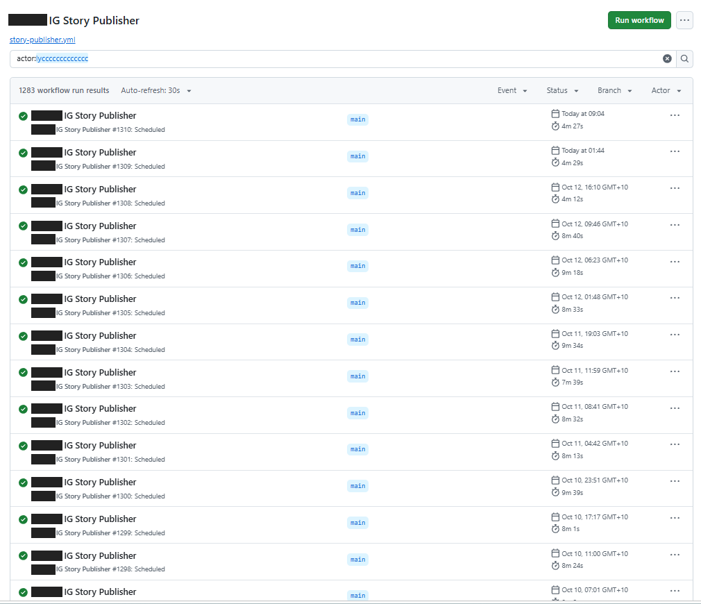
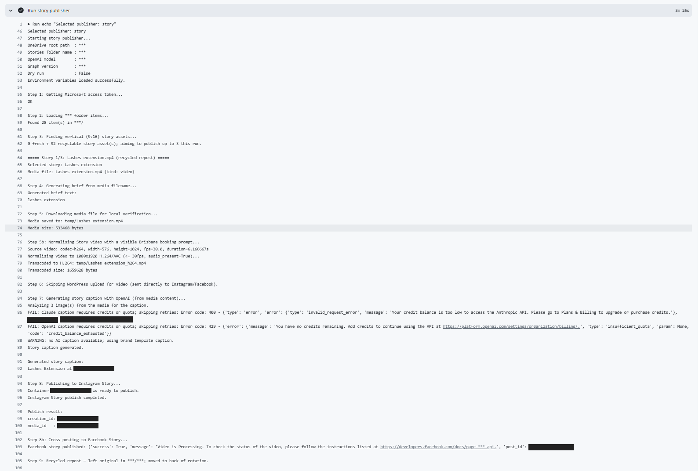
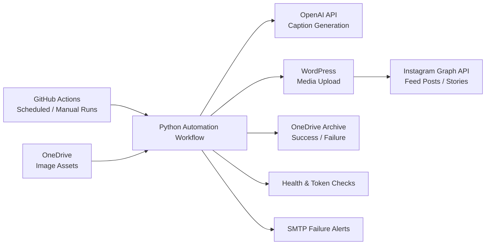

# AI Social Media Publisher

A production Python automation that connects cloud storage, AI caption generation, media hosting and Instagram publishing into an unattended, scheduled workflow for a real small business.

> **In production since May 2026.** 1,600+ scheduled runs across the story and feed-post workflows, with a 94% success rate.

## Demo

**Scheduled run history.** Every run is triggered automatically by GitHub Actions.



**A complete scheduled run.** The pipeline gets an access token, loads assets from OneDrive, generates a caption, publishes to Instagram and archives the asset. In this run both AI providers were out of credits, so the workflow fell back to a template caption and still published successfully.



*Screenshots from the current production deployment, which builds on my original pipeline with later collaborative extensions (video, Facebook). Client details are redacted.*

## Problem

A small business needed a more reliable way to publish social media content without repeatedly downloading assets, writing captions, uploading media, publishing posts manually and monitoring each run.

## Solution

I designed and built a Python workflow, run by GitHub Actions on a schedule, that:

1. Pulls image assets from a OneDrive folder through the Microsoft Graph API.
2. Generates Instagram captions with the OpenAI API.
3. Uploads media to WordPress to get a public URL.
4. Publishes feed posts and stories through the Instagram Graph API.
5. Archives each asset to a success or failure folder in OneDrive.
6. Sends an email alert when a run fails.

## Architecture



## My Contribution

I was the original and sole developer of the system from May 6 to May 28, 2026. This repository contains that version, prepared for portfolio use. My work included:

- **Publishing pipeline:** separate feed-post and story publishers, from OneDrive asset to live Instagram content.
- **Reliability:** retries with error logging for the OpenAI, Instagram Graph and Microsoft Graph APIs, plus fail-fast WordPress uploads.
- **Archiving:** success and failure archive folders, with filename-conflict handling so no asset is overwritten or processed twice.
- **Monitoring:** a health-check script for environment and API connectivity, a weekly Meta token validity check, and SMTP email alerts on failure.
- **Scheduling:** GitHub Actions workflows with independent post and story schedules, manual dispatch and selectable modes (publish, health check, token check, test alert).
- **Security:** credentials kept out of source control in environment variables and GitHub repository secrets, plus a dry-run mode for safe testing.

## Later Extensions (Collaborative)

From July 2026 I continued working on the system with another developer. Together we extended it with:

- Video support for Reels and Stories, including ffmpeg transcoding to 1080×1920 H.264.
- Facebook Page cross-posting alongside Instagram.
- Captions generated from the media content itself using vision models, with a fallback across AI providers.
- Scheduled cleanup of processed files in OneDrive.

These extensions run in the client's production deployment and are not included in this repository.

## Production Results

| Workflow | Successful runs | Failed runs | Success rate |
|---|---|---|---|
| Stories | 1,283 | 64 | 95.2% |
| Feed posts | 257 | 28 | 90.2% |
| **Total** | **1,540** | **92** | **94.4%** |

Figures are as of October 2026. Failures trigger an email alert, and failed assets go to a separate archive folder for review.

## Project Structure

- `post_publisher.py`: feed post workflow.
- `story_publisher.py`: story workflow.
- `wordpress_media.py`: WordPress media upload helper.
- `asset_helpers.py`: asset filename helpers.
- `health_check.py`: environment and API connectivity checks.
- `token_maintenance.py`: Meta token validity check.
- `alert_email.py`: SMTP alert helper.
- `send_test_alert.py`: sends a test alert email.
- `.github/workflows/`: GitHub Actions automation.
- `.env.example`: placeholder configuration template.

## Setup

1. Create a virtual environment.
2. Install dependencies:

   ```
   pip install -r requirements.txt
   ```

3. Copy `.env.example` to `.env` and replace the placeholders with your own credentials.
4. Keep `.env` private. It is ignored by Git.

## Required Services

- Microsoft Graph API access for OneDrive.
- Meta Graph API access for Instagram publishing.
- OpenAI API access for caption generation.
- A WordPress application password for media uploads.
- An SMTP account for alerts (optional).

## Common Commands

```
python health_check.py
python post_publisher.py
python story_publisher.py
python token_maintenance.py
python send_test_alert.py
```

Set `DRY_RUN=true` while testing to skip live Instagram publishing.

## Security Notes

This repository is prepared for portfolio use. Real credentials, private account identifiers, emails, domains, client names, generated media, logs and cache folders are not committed. Workflow configuration uses GitHub repository secrets.
