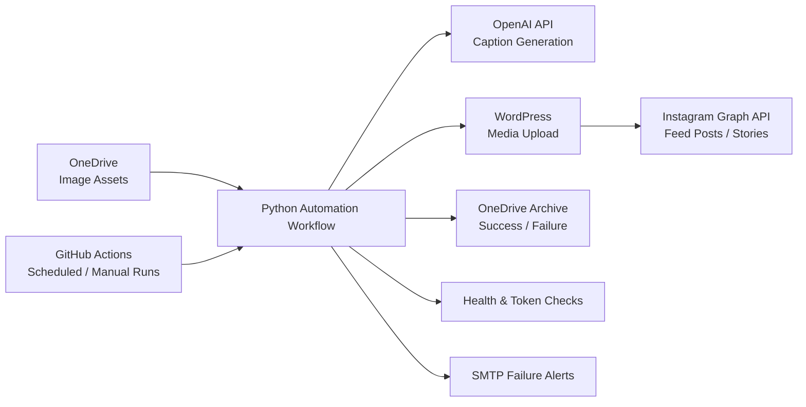

# AI Social Media Publisher

A production-oriented Python automation that connects cloud storage, AI content generation, media hosting, and social publishing into a reliable unattended workflow for a real business use case.

## Problem

A small business needed a more reliable way to publish social media content without repeatedly downloading assets, writing captions, uploading media, publishing posts manually, and monitoring each run.

## Solution

I built a Python automation workflow that connects OneDrive, OpenAI, WordPress, and the Instagram Graph API to automate the publishing process end to end.

The workflow can pull image assets from OneDrive, generate Instagram captions with OpenAI, upload media to WordPress, publish feed posts or stories through the Meta Graph API, archive processed files, and send SMTP alerts when jobs fail.

## Why This Project Matters

This project demonstrates more than basic API integration. It required handling scheduled execution, authentication, external service failures, retries, health checks, archiving, token validation, and alerting so the workflow could run reliably without constant manual supervision.

It gave me practical experience designing automation that connects multiple external systems and needs to remain observable, testable, and resilient when individual services fail.

## Architecture



## Engineering Highlights

- Integrates OneDrive, OpenAI, WordPress, and Instagram through external APIs.
- Runs automatically through GitHub Actions using scheduled or manual workflows.
- Uses retry handling, health checks, and token checks for unattended operation.
- Archives successful and failed assets to support traceability and avoid reprocessing.
- Sends optional automated email alerts when workflows fail.
- Keeps credentials outside source control through environment variables and GitHub repository secrets.
- Supports dry-run testing before live Instagram publishing.

## Features

- Publishes Instagram feed posts and stories from OneDrive folders.
- Generates captions from asset filenames using the OpenAI API.
- Uploads media to WordPress before publishing.
- Archives successful and failed assets into configured OneDrive folders.
- Includes health checks, token checks, and optional email alerts.
- Provides GitHub Actions workflows for scheduled or manual runs.

## Project Structure

- `post_publisher.py`: feed post workflow.
- `story_publisher.py`: story workflow.
- `wordpress_media.py`: WordPress media upload helper.
- `health_check.py`: environment and API connectivity checks.
- `token_maintenance.py`: Meta token validity check.
- `alert_email.py`: SMTP alert helper.
- `.github/workflows/`: GitHub Actions automation.
- `.env.example`: placeholder configuration template.

## Setup

1. Create a virtual environment.
2. Install dependencies:

```bash
pip install -r requirements.txt
```

3. Copy `.env.example` to `.env` and replace placeholders with your own credentials.
4. Keep `.env` private. It is intentionally ignored by Git.

## Required Services

- Microsoft Graph API access for OneDrive.
- Meta Graph API access for Instagram publishing.
- OpenAI API access for caption generation.
- WordPress application password for media uploads.
- Optional SMTP account for alerts.

## Common Commands

```bash
python health_check.py
python post_publisher.py
python story_publisher.py
python token_maintenance.py
python send_test_alert.py
```

Set `DRY_RUN=true` while testing to skip live Instagram publishing.

## Security Notes

This repository is prepared for portfolio use. Real credentials, private account identifiers, emails, domains, client names, generated media, logs, and cache folders should not be committed. Use GitHub repository secrets for workflow configuration.
